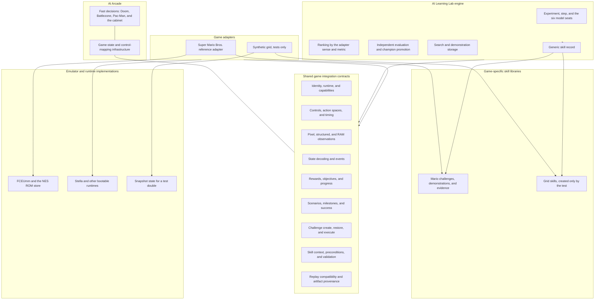

# Learning Lab boundaries

The lab trains, evaluates, and records skills. A game adapter tells it what the
game is. The engine does not import a game, and a game adapter does not import
the lab's training loop.

AI Arcade and the Learning Lab meet at the contracts. Neither one calls the
other's decider or trainer. `games.lab.integrations` is the composition root:
it is the one engine-tree module allowed to import the Mario adapter.
`games.lab.registry` loads that root on first use. A test can register a
different adapter and leave the root unloaded.

Mario tools live in `games.lab.mario`. The pinned ROM check lives there too.
The bytes stay outside git.

## What stayed game-specific on purpose

- World, stage, flagpole, and warp predicates live on the Mario adapter.
- The castle-walk score correction lives on that adapter and is applied when a
  tape belongs to it.
- Hint world and stage limits are the Mario adapter's context check. The page
  asks the active adapter before it saves a hint.
- Skill documents may carry a game context. The engine stores the context and
  does not require a world or a stage.
- Comparison direction is `maximize` or `minimize`, and the metric name comes
  from the protocol. A bootable title with no adapter still ranks by survival,
  and that sense is maximize.

## Behavior that changed with the extraction

- `record_mastery` writes `verified_fixed_state` for one independent scenario.
  It writes `generalized` when the evaluation lists at least two conditions
  and each condition recorded its own success on a distinct start. A declared
  flag, or a list of starts, leaves the agent at verified_fixed_state. Older
  files that say `independently_mastered` still read as verified from a fixed
  state. Those files were not rewritten.
- `make_tape` stores world and stage when the caller passes them, and stores
  a context only when the caller supplies one. A tape with neither world nor
  stage omits those keys. New Mario tapes still pass both.
- Maximize training keeps the high-water mark and the buttons that reached it.
  Minimize training records the finished episode and saves that episode's
  buttons. A floor of 0 does not block the shared run. On a minimize metric,
  a score above a nonzero floor stays on the seat tape.
- `worker.main --practice` opens the adapter environment, steps a stub policy,
  and writes a tape and status in the seat directory. It does not load a
  training library or write a checkpoint. The supervisor does not pass that
  flag. The real training path calls `open_env` when the adapter has one.
  Mario's `open_env` builds the scored environment for the ROM it is given.
- `python -m games.lab.eval` requires `--game`. The adapter id selects the
  protocol. There is no implicit game.
- Mario smoke, capture, proof, and model smoke run as `python -m games.lab.mario.<tool>`.
- New round manifests and new evaluations record `sense` and, when the round
  has one, `integration`. Older files stay as they were.
- New challenge descriptions record `identity_keys` and `state_format`. The
  default format is still `libretro-serialize`. Existing version 1 states load.
- New skill documents are version 2. Version 1 documents still load.
- Training-score champion selection and round ranking take an explicit sense.
  A missing sense does not invent a parent.

## Debt that is still game-shaped

- A tape with no integration id, a progress or x objective, and a world or
  stage is still claimed by the Mario adapter so old runs stay readable.
- When two tapes tie on the metric, the engine still prefers more time left,
  then fewer presses. That assumes a remaining clock.
- A tape nobody claims is ranked as maximize.
- The NES boot path still waits through the Wrecking Crew title string before
  it saves a state. That string is on the title screen the runtime skips.
- Linux cores need their own savestate capture. The committed states are the
  Windows FCEUmm core.
- The ceiling skill's `on-upper-path` benchmark is evidence for that saved
  state. It is not a promotion benchmark.
- Five successes from one deterministic state are verified from that state.
  They are not a claim that the policy generalized.
- The practiced PPO/CNN zip stays gitignored beside the ceiling challenge.
  `practice.json` records the relative path, sha256
  `908c1e4b4e3037376b1a34ce36143ed2688110d7941dc1ccd2267fd6ec8e7691`, and a
  backup at `C:\Users\Mike\mario-runs\artifacts\smb-1-2-ceiling-lift\practice-ppo-cnn.zip`
  with the same checksum.
- Curriculum stages are described and not implemented. Unassisted play from
  the start of the game is still open.
- The production registry installs one adapter. The grid adapter exists only
  in the tests.
